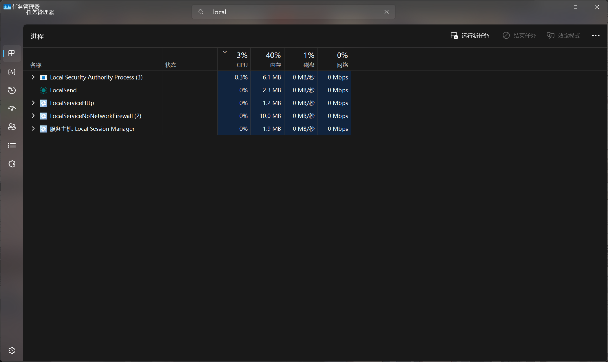
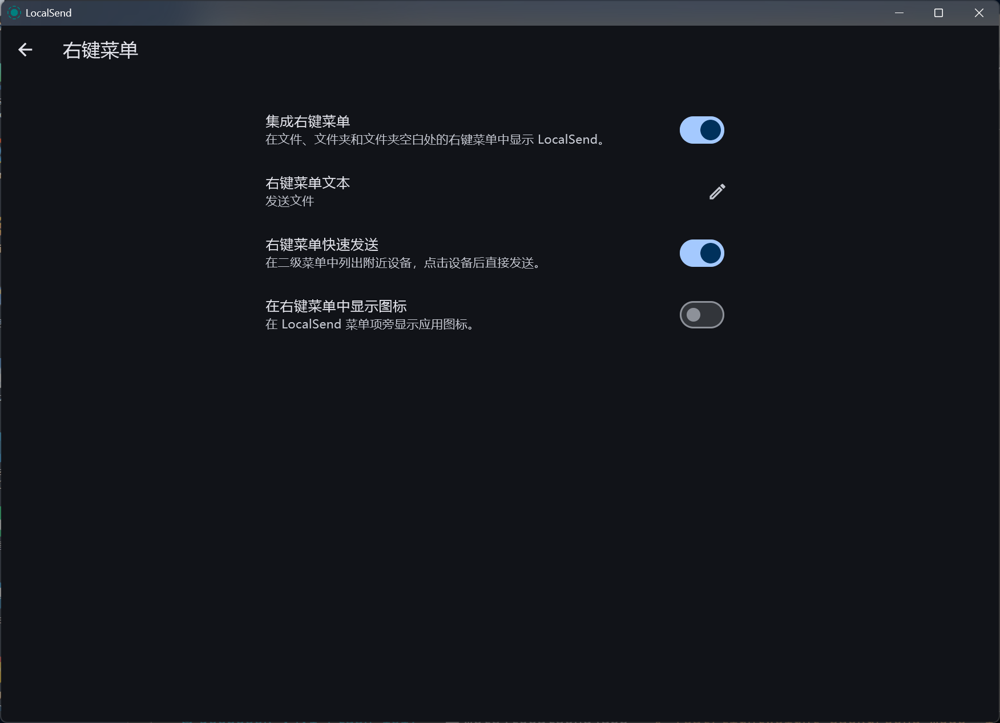
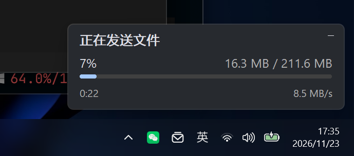
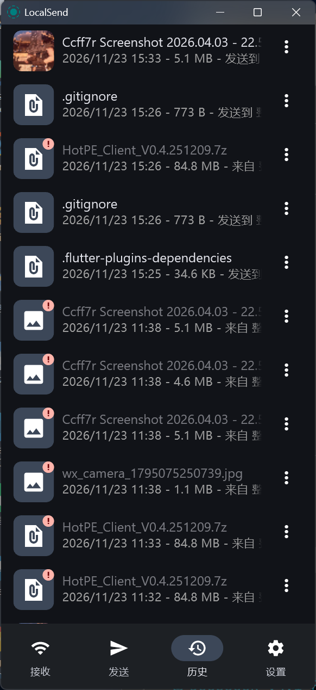

# LocalSendPro

基于 LocalSend 的 Windows 增强版。以下只列出新增特性。

## 右键菜单快速发送

- 在文件、文件夹和文件夹空白处的右键菜单中集成 LocalSend。
- 开启快速发送后，右键菜单直接展开附近设备子菜单，点击设备即可发送。
- 支持多选文件合并为同一个发送会话。
- 发送过程保持主窗口隐藏，通过原生通知显示状态。
- 可自定义右键菜单文本，并可选择是否显示应用图标。

## 原生通知窗口

- 查找设备、等待接收、传输进度、完成和失败状态统一显示在 Windows 原生通知窗口。
- 查找阶段会重新确认设备是否在线，连接失败的设备会从附近列表和右键菜单中清除。
- 已存在的设备点击后立即开始发送，同时后台刷新设备状态。
- 从查找、等待到完成的跑马灯动画保持连续，不会因为阶段切换重置。
- 传输完成后保留 100% 进度条，并按配置的显示时长自动关闭。
- 通知支持关闭按钮，失败或取消时不会留下无法消失的残留窗口。

## PIN 与请求状态

- 接收方启用 PIN 时，可直接在原生通知窗口中输入 PIN。
- PIN 错误可重试，取消则终止发送。
- 对方已有等待确认的请求时，会显示占用提示，避免重复请求。
- 接收方拒绝、忙碌、超时或连接中断时，显示明确的失败原因。

## 右键菜单设置

- 独立的“右键菜单”设置页。
- 可分别控制：集成右键菜单、快速发送、菜单图标、自定义菜单文本。
- 快速发送默认关闭，开启后才会写入设备子菜单。
- 设备列表与发现结果同步，离线设备不会继续出现在菜单中。

## 截图

| 右键菜单设置 | 快速发送 |
|---|---|
|  |  |

| 原生通知 | PIN 输入 |
|---|---|
|  |  |
